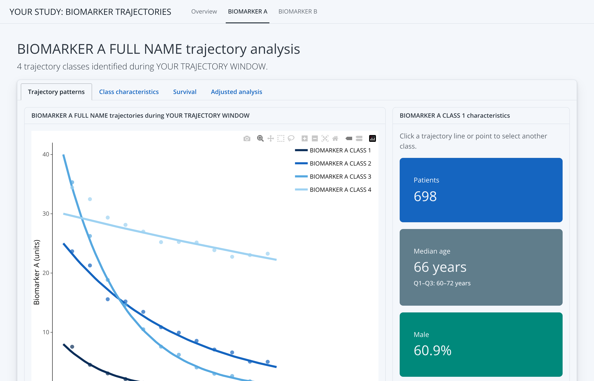

# Biomarker Trajectory Dashboard

Reusable R code for finding patterns in repeated biomarker measurements and linking those patterns to patient outcomes, with an interactive Shiny dashboard to explore the results.

It was built for a longitudinal biomarker analysis of the **Myeloma XI** trial (Leeds Institute of Clinical Trials Research), and has been made generic so it can be used with any study that has repeated biomarker measurements and time-to-event outcomes.

**Live dashboard (Myeloma XI results):** https://yj0fqs-damilola-ogungbemi.shinyapps.io/myeloma-xi-biomarker-dashboard/

> Exploratory research tool. Not a clinically validated prediction system.


*The dashboard running on synthetic demo data.*

---

## The question it answers

Two patients can start treatment with the same biomarker level and end up with very different outcomes. The pattern of change over the first few months may say more than any single measurement.

This code asks: **do groups of patients share a similar biomarker pattern early in treatment, and do those groups go on to have different outcomes?**

## How it works

1. **Find the patterns.** Latent class growth analysis (LCGA) fits models with one to four groups. Each group follows its own average curve over time.
2. **Pick the number of groups.** Compare models using BIC (fit), entropy (how clearly patients separate) and group sizes, alongside clinical sense.
3. **Assign patients.** Each patient joins the group they most likely belong to.
4. **Link to outcomes.** Use a landmark at the end of the trajectory window. Compare progression-free and overall survival across groups with Kaplan–Meier curves and Cox models, unadjusted and adjusted for key covariates.
5. **Explore.** The dashboard shows the curves, who is in each group, survival and hazard ratios.

## What's in this repository

```
R/lcga_template.R                    LCGA model fitting, selection and trajectory plot
dashboard/app.R                      Shiny dashboard
demo/make_demo_dashboard_data.R      Generates FAKE inputs so the dashboard runs
```

## Data governance

The Myeloma XI data are controlled-access clinical trial data. **No patient-level data, and no study outputs, are included in this repository.**

- The code was reviewed and approved for public release by the study supervisor before publication.
- The dashboard only reads pre-aggregated summary files, never patient-level data.
- `dashboard/dashboard_data/` and `dashboard/www/` are ignored by git, so outputs placed there can't be committed by mistake.
- The demo data are simulated from scratch and carry no information about any real patient or study.

## Quick start: run the dashboard with demo data

Install R packages:

```r
install.packages(c("shiny", "bslib", "bsicons", "plotly", "dplyr", "tidyr",
                   "ggplot2", "ggtext", "scales", "survival"))
```

From the repository root:

```r
source("demo/make_demo_dashboard_data.R")
shiny::runApp("dashboard")
```

## Using it with your own study

**Trajectory model:** open `R/lcga_template.R` and edit Section 2 only. Point it at your prepared data and name your patient ID, time and biomarker columns. It needs these packages: `lcmm`, `tidyverse` and `gt`.

**Dashboard:** edit Section 2 of `dashboard/app.R` (labels, class names, study details). Then put your approved aggregate files in `dashboard/dashboard_data/` and images in `dashboard/www/`. The demo script shows exactly what structure each file needs.

Only use outputs that have passed your organisation's output checking (for example, small-number suppression) before they leave a secure environment.

## Limitations and notes

- Groups come from the data. They are descriptive, not established clinical categories, and should be validated in an independent cohort.
- LCGA assumes no individual variation within a group. Growth mixture models relax this.
- Multi-class models start from the one-class solution. For new data, consider `lcmm::gridsearch()` with multiple random starts to reduce the risk of local maxima.
- The trajectory plot code expects two or more classes.

## Acknowledgements

This work was done during the LIDA Data Scientist Development Programme at the University of Leeds. Thanks to the Myeloma XI trial team and the Leeds Institute of Clinical Trials Research.

## Author

**Damilola Ogungbemi**, Health Data Scientist

## Licence

MIT. See [LICENSE](LICENSE).
